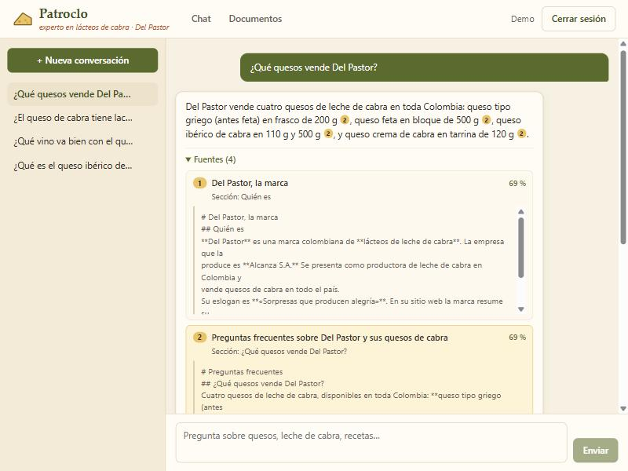
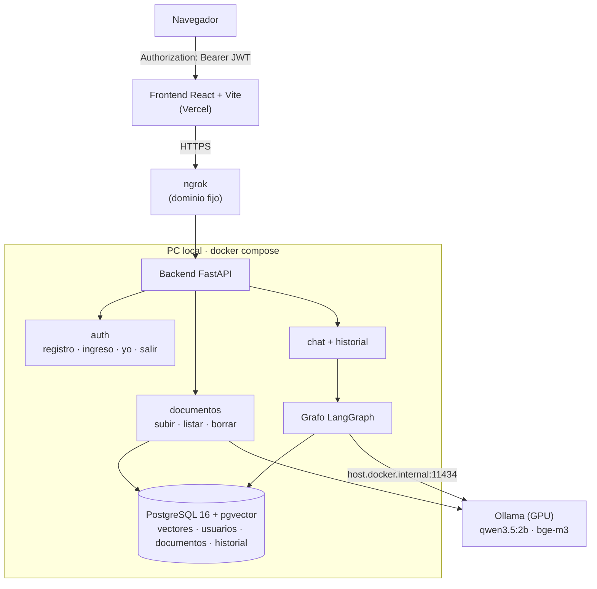
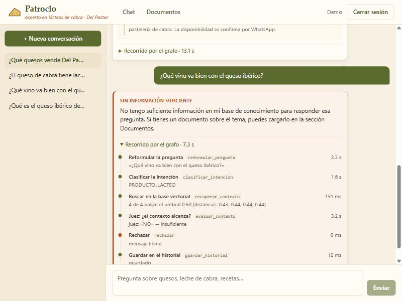

# Patroclo — el experto en lácteos de cabra de Del Pastor

Aplicación web con un **agente RAG** construido con **LangChain + LangGraph** que responde
preguntas sobre los quesos y lácteos de cabra de **Del Pastor** (Alcanza S.A.) **solo con su
base de conocimiento**, usando un **modelo local** (Ollama) y **pgvector**. Si la respuesta no
está en los documentos, lo dice.

Trabajo final del curso de Implementación (EIA, semestre 6). Enunciado:
[`docs/enunciado-trabajo-agente.pdf`](docs/enunciado-trabajo-agente.pdf).



> **Estado (17/10/2026):** backend, agente, frontend y pruebas terminados. **Falta el
> despliegue en la nube** (todo preparado; faltan las cuentas de ngrok y Vercel). El registro
> detallado de cada paso, las decisiones y los problemas está en [`ESTADO.md`](ESTADO.md).

---

## Qué cumple del enunciado (PDF §6.1)

| Requisito mínimo | Estado | Dónde |
|---|---|---|
| Backend y frontend funcionales | ✅ | `backend/` (FastAPI), `frontend/` (React) |
| Autenticación (registro, ingreso, sesión, cierre; API protegida) | ✅ | JWT propio + argon2id; una prueba recorre **todas** las rutas y exige 401 sin token |
| Agente con LangChain + LangGraph | ✅ | `backend/agents/` — grafo de 8 nodos ([diagrama](docs/grafo.md)) |
| Modelo local | ✅ | Ollama: `qwen3.5:2b` (chat) + `bge-m3` (embeddings) |
| Base vectorial + carga de documentos desde el frontend | ✅ | PGVector; PDF, TXT, MD, DOCX, CSV |
| Respuestas fundamentadas en el contexto | ✅ | Citas `[n]` con la fuente y el fragmento visibles |
| Rechazo explícito sin información | ✅ | Mensaje literal del enunciado; **7 controles** de alucinación |
| Despliegue en la nube y repositorio documentado | ⏳ | Preparado (ngrok + Vercel); ver [Despliegue](#despliegue-pendiente) |

**Evaluación con 20 casos** ([`evaluacion/casos.json`](evaluacion/casos.json)):
**20/20** con `qwen3.5:2b`, ≈14 s por respuesta (detalle en `ESTADO.md`, paso 4).

---

## Arquitectura



### El grafo del agente

```text
START → reformular_pregunta → clasificar_intencion ─┬─ SALUDO ──────────→ responder_saludo ─┐
                                                    ├─ FUERA_DE_DOMINIO → rechazar ─────────┤
                                                    └─ PRODUCTO_LACTEO                      │
                                                          ↓                                 │
                              recuperar_contexto (k=4, umbral de distancia 0,50)            │
                                                          ↓                                 │
                              evaluar_contexto (LLM juez) ── insuficiente → rechazar ───────┤
                                                          ↓ suficiente                      │
                              generar_respuesta (solo contexto, cita [n]) ── NO_SE → rechazar
                                                          ↓                                 │
                                                  guardar_historial ←───────────────────────┘ → END
```

Las **decisiones** (aristas) las toma código que lee el estado; el modelo solo llena el
estado con una palabra o con la respuesta. Diagrama generado desde el código y tabla de
nodos: [`docs/grafo.md`](docs/grafo.md).

### Control de alucinaciones (el PDF pide 2; hay 7)

| # | Estrategia | Nodo |
|---|---|---|
| 1 | Umbral mínimo de similitud (distancia coseno ≤ 0,50, calibrada con los casos) | `recuperar_contexto` |
| 2 | Nodo juez: «¿el contexto trae el dato pedido?» | `evaluar_contexto` |
| 3 | Prompt que obliga a usar solo el contexto y citar `[n]` | `generar_respuesta` |
| 4 | Rechazo explícito con el mensaje literal del enunciado | `rechazar` |
| 5 | Fuentes y fragmentos visibles en la interfaz | respuesta + UI |
| 6 | Clasificador de intención que corta lo fuera de dominio (con corrección por código) | `clasificar_intencion` |
| 7 | Si el generador responde `NO_SE`, se rechaza | arista `generar_respuesta → rechazar` |



*«¿Qué vino va con el ibérico?»: los 4 fragmentos pasan el umbral (0,43–0,44), pero el juez
dice que no traen el dato → rechazo. El frontend muestra el recorrido nodo por nodo.*

---

## Tecnologías

| Capa | Tecnología |
|---|---|
| Agente | LangGraph 1.2 (`StateGraph`), LangChain Core, `langchain-ollama`, `langchain-postgres` |
| Modelo local | Ollama en Docker con GPU — `qwen3.5:2b` (chat), `bge-m3` (embeddings, 1024 dim.) |
| Base vectorial | PostgreSQL 16 + pgvector 0.8 (`PGVector`, metadata JSONB) |
| Backend | FastAPI, SQLAlchemy 2, pydantic-settings, PyJWT, argon2-cffi, pypdf, python-docx — Python 3.12 con uv |
| Frontend | React 19, Vite 8, TypeScript 5.9, React Router 7 (sin librería de componentes) |
| Infraestructura | Docker Compose; ngrok (backend) y Vercel (frontend) para el despliegue |

---

## Cómo correrlo localmente

### Requisitos

- **Docker Desktop** (en Windows, con WSL2; para usar la GPU NVIDIA, los drivers al día).
- **[uv](https://docs.astral.sh/uv/)** (instala Python 3.12 solo) y **Node.js 20+**.
- **Ollama** corriendo en `localhost:11434`. Si no lo tienes, en un contenedor:

```bash
docker run -d --gpus=all -v ollama:/root/.ollama -p 11434:11434 --name ollama-gpu ollama/ollama
```

  (sin GPU, quita `--gpus=all`: funciona, pero más lento). Luego descarga los modelos:

```bash
docker exec ollama-gpu ollama pull qwen3.5:2b
```

```bash
docker exec ollama-gpu ollama pull bge-m3
```

### 1. Variables de entorno

```bash
cp .env.example .env
```

Abre `.env` y cambia al menos `POSTGRES_PASSWORD` y `JWT_SECRETO` (este último de 32 o más
caracteres; el archivo explica cómo generar uno). **`.env` nunca se sube al repositorio.**

### 2. Base de datos + API (Docker)

```bash
docker compose up -d --build
```

Al arrancar, el contenedor de la API **indexa la base de conocimiento** (`conocimiento/`,
16 archivos → 131 fragmentos; la primera vez ≈1 min) y precarga los modelos en Ollama.
Comprueba que todo esté bien:

```bash
curl http://localhost:8000/health
```

Debe responder `"estado":"ok"` con la base y los dos modelos. La documentación interactiva de
la API queda en http://localhost:8000/docs.

### 3. Frontend

```bash
npm install --prefix frontend
```

```bash
npm run dev --prefix frontend
```

Abre http://localhost:5173, crea una cuenta y pregunta. Para la demo de carga, arrastra
[`demo-carga/guia-maridaje-vinos-quesos-de-cabra.pdf`](demo-carga/README.md) en la pantalla
**Documentos**: antes, «¿qué vino va con el ibérico?» se rechaza; después, se responde
citando la guía.

---

## Pruebas y evaluación

Desde `backend/`:

| Comando | Qué hace | Necesita |
|---|---|---|
| `uv run pytest` | **77 pruebas**: autenticación, rutas protegidas, extracción y fragmentación, documentos, grafo (con modelo falso), chat e historial, configuración | nada (SQLite en memoria y modelo falso) |
| `uv run pytest -m integracion` | Los 20 casos de `casos.json` contra el modelo y la base reales | Docker + Ollama arriba |
| `uv run python -m app.evaluar [--modelo X]` | Tabla de los 20 casos (acierto, tiempo, fuente); guarda `evaluacion/resultados-<modelo>.json` | Docker + Ollama |
| `uv run python -m app.calibrar_umbral` | Distancias por caso para calibrar `UMBRAL_DISTANCIA` | Docker + Ollama |
| `docker exec patroclo-api python -m app.semilla --reindexar` | Recalcula todos los vectores (al cambiar `EMBEDDING_MODEL`) | Docker + Ollama |

**Comparación de modelos** (mismos casos y prompts):

| Modelo | Casos correctos | Tiempo por respuesta | Nota |
|---|---|---|---|
| **`qwen3.5:2b`** (por defecto) | **20/20** | ≈14 s | A veces agrega una inferencia pequeña |
| `qwen3.5:4b` | 19/20 | ≈50 s | Redacta mejor; no cabe entero en 4 GB de VRAM |

---

## Estructura del repositorio

```text
Patroclo-Local/
├── backend/
│   ├── app/            main.py, config.py, dependencias (auth), errores, semilla, evaluar, calibrar_umbral
│   ├── controllers/    rutas: health, auth, documentos, chat, historial
│   ├── services/       usuarios, tokens, extraccion, fragmentacion, ingesta, historial, chat, modelo_local
│   ├── agents/         estado, prompts, llm (crear_llm), nodos, grafo
│   ├── vectorstore/    PGVector + embeddings de Ollama
│   ├── db/             modelos SQLAlchemy, conexión, init.sql
│   └── tests/          77 pruebas + 20 de integración
├── frontend/src/       api/ (cliente y tipos), sesion/, paginas/ (Ingreso, Chat, Documentos), componentes/
├── conocimiento/       base de conocimiento inicial (16 archivos Markdown con frontmatter)
├── demo-carga/         PDF que se sube en vivo en la sustentación (no se indexa al inicio)
├── evaluacion/         casos.json (20 casos) y resultados por modelo
├── docs/               enunciado, diagrama del grafo, capturas
├── docker-compose.yml  postgres + api (+ ngrok con el perfil «publico»)
├── .env.example        todas las variables, documentadas
└── ESTADO.md           registro de cada paso: qué se hizo, por qué, qué falló
```

## API

Todas las rutas salvo `/health`, registro e ingreso exigen `Authorization: Bearer <token>`.

| Método y ruta | Qué hace |
|---|---|
| `GET /health` | Estado de la base y del modelo local (200 / 503) |
| `POST /api/auth/registro` · `POST /api/auth/ingresar` | Devuelven `{token, expira_en, usuario}` (JWT de 8 h) |
| `GET /api/auth/yo` · `POST /api/auth/salir` | Usuario actual · revoca el token |
| `POST /api/chat` `{pregunta, conversacion_id?}` | `{respuesta, fuentes[], pasos[], rechazada, tiempo_ms, conversacion_id}` |
| `GET /api/conversaciones` · `GET/DELETE /api/conversaciones/{id}` | Historial del usuario (solo las suyas) |
| `POST /api/documentos` (multipart) · `GET /api/documentos` · `DELETE /api/documentos/{id}` | Subir (idempotente por sha256), listar, borrar (solo quien lo subió) |

---

## Despliegue (pendiente)

Preparado y documentado en `ESTADO.md`, paso 7:

- **Backend:** corre en el PC local y se publica con **ngrok** (dominio fijo gratuito):
  `docker compose --profile publico up -d` (necesita `NGROK_AUTHTOKEN` y `NGROK_DOMAIN` en
  `.env`). Sin el perfil, nada queda expuesto a internet.
- **Frontend:** **Vercel** (`frontend/vercel.json`), con `VITE_API_URL` = la URL de ngrok.
- Agregar la URL de Vercel a `ORIGEN_FRONTEND` (CORS) y poner `MOSTRAR_DOCS=false`.

URLs públicas: *pendientes.*

## Limitaciones conocidas

- **El PC tiene que estar prendido durante la demo** (el backend y el modelo corren ahí).
- **GPU de 4 GB:** ningún modelo de chat cabe entero; `qwen3.5:2b` responde en ≈10–15 s.
- El modelo de 2B **a veces mezcla datos de fragmentos cercanos** (ej.: llamó DOP al
  ibérico). Las fuentes visibles permiten detectarlo; `qwen3.5:4b` no lo hace, pero tarda 50 s.
- Con ngrok arriba, **cualquiera con la URL puede registrarse** (el enunciado pide registro
  abierto): ngrok solo durante pruebas y la sustentación.
- Sin límite de intentos en `/ingresar` ni de subidas por usuario (anotado como mejora).

## Trabajo futuro

Un **mini-Patroclo de WhatsApp** que atienda clientes con esta misma base. Ya está preparada
la columna `visibilidad` (`publico` / `interno`) en documentos y fragmentos, y el grafo
acepta `solo_publico=True`: el filtro lo aplica la consulta a la base, no el prompt.

---

## Guía para revisar (compañeros)

Sugerencia de recorrido, de 20 a 30 minutos:

1. **Leer** este README y la tabla de avance de [`ESTADO.md`](ESTADO.md).
2. **El grafo:** [`backend/agents/grafo.py`](backend/agents/grafo.py) (aristas) y
   [`backend/agents/nodos.py`](backend/agents/nodos.py) (cada nodo). ¿Se entiende por qué
   cada pregunta toma su camino?
3. **Seguridad:** [`backend/app/dependencias.py`](backend/app/dependencias.py) y
   [`backend/tests/test_rutas_protegidas.py`](backend/tests/test_rutas_protegidas.py).
4. **Correrlo** (sección de arriba) y probar: una pregunta que esté en la base, una ajena
   (sushi, fútbol), una del tema que la base no responde (precio, año de fundación), el
   seguimiento «¿y con qué lo sirvo?», y la carga del PDF de vinos.
5. **Buscar fallos:** respuestas con datos que no estén en la fuente citada, preguntas
   buenas que rechace, errores en la interfaz.

Para comentar: abran un *issue* en GitHub o escríbanle a Pedro con la pregunta exacta, la
respuesta que dio y lo que esperaban.

---

*Base de conocimiento escrita a partir de https://delpastor.com/ y de fuentes públicas
citadas al final de cada archivo de `conocimiento/`. Sin precios, NIT ni datos de clientes.*
