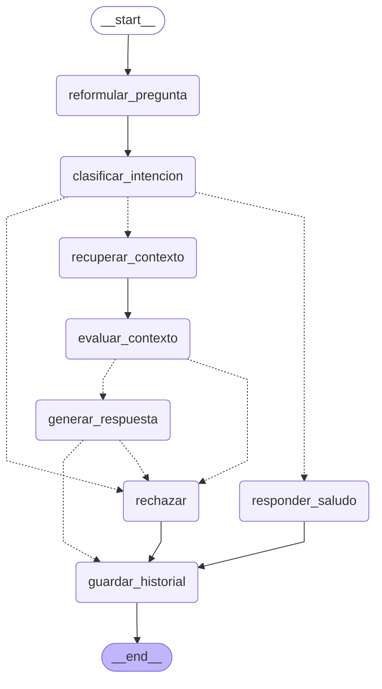

# El grafo de Patroclo (LangGraph)

Generado desde el código con `construir_grafo(...).get_graph().draw_mermaid()`
(`backend/agents/grafo.py`). Las flechas punteadas son aristas condicionales: las decide
código que lee el estado, no el modelo.

| Nodo | Usa el modelo | Qué hace |
|---|---|---|
| reformular_pregunta | solo si hay historial | Reescribe la pregunta para que se entienda sola |
| clasificar_intencion | sí (1 palabra) | SALUDO / PRODUCTO_LACTEO / FUERA_DE_DOMINIO; el código corrige si nombra términos del dominio |
| recuperar_contexto | no (embeddings) | k=4 fragmentos de PGVector; descarta los de distancia > UMBRAL_DISTANCIA |
| evaluar_contexto | sí (1 palabra) | Juez: ¿el contexto trae el dato pedido? Sin fragmentos → insuficiente sin llamar al modelo |
| generar_respuesta | sí | Responde solo con el contexto, citando [n]; si escribe NO_SE se rechaza |
| rechazar | no | Mensaje literal del enunciado + sugerencia de cargar documentos |
| responder_saludo | no | Mensaje fijo de presentación |
| guardar_historial | no | Guarda pregunta, respuesta, fuentes y pasos (paso 5) |
